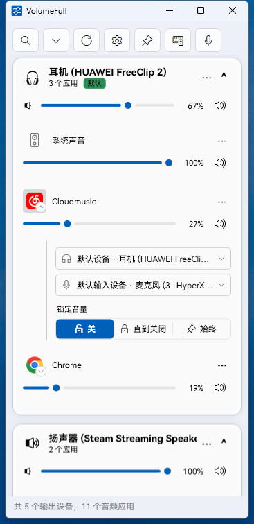

# VolumeFull

基于 WPF (.NET 8) 的 Windows 音量控制工具：按应用调节音量、输入/输出设备路由、音量锁定、托盘菜单与全局快捷键。

  

## 功能

- 全部输出设备卡片（默认设备置顶、默认徽章）
- 每个应用的音量/静音调节，应用图标 + 峰值可视化条
- 音量记忆（按应用恢复，以记忆音量启动）
- 音量锁定三态：关 / 直到关闭 / 始终，应用名旁显示锁定徽章
- 每个应用可单独选择 **输出设备** 和 **输入设备**（与 Win11 音量合成器同款进程级路由）
- 系统级 **输入设备切换**：工具栏麦克风按钮、托盘「输入设备」子菜单
- 声道平衡（左右声道独立调节）
- 深浅主题 / 跟随系统，配色对齐 Windows 11
- 弹出模式（托盘上方弹出，点击别处自动隐藏）/ 记住弹出位置
- 启动音量上限（新启动的应用音量自动降到设定值）
- 按名称搜索应用（放大镜按钮 + 弹出输入框）
- 全局快捷键（音量增减 / 静音 / 显示面板 / 切换设备），支持冲突提示与「独占快捷键」
- 系统托盘（音量图标 / 应用图标可切换），菜单可直接切输出/输入设备
- 直达系统声音控制面板 / Windows 声音设置
- 关于页（版本号、源代码、问题反馈）
- 窗口、面板、列表展开的过渡动画（跟随系统「动画效果」设置）
- 全界面统一 HarmonyOS Sans SC 字体（随程序内嵌）

## 下载

从 [Releases](https://github.com/PhilYuMo/VolumeFull/releases) 下载（资产名带版本号）：

- `VolumeFull-v<版本>-portable.zip`：便携版，解压后双击 `VolumeFull.exe` 即可运行（self-contained，无需安装 .NET）
- `VolumeFull-v<版本>-Setup.exe`：安装版，内嵌便携版载荷，可自选安装目录并注册卸载信息

## 技术栈

- .NET 8.0 / WPF
- CoreAudio COM 互操作（IAudioSessionControl2 / ISimpleAudioVolume / IChannelAudioVolume / IAudioMeterInformation / IAudioEndpointVolume / IPolicyConfig / IAudioPolicyConfigFactory）
- 全局快捷键：WH_KEYBOARD_LL 低级键盘钩子
- H.NotifyIcon.Wpf（托盘）
- HarmonyOS Sans SC（内嵌于程序集）

## 说明

- 便携版需整体复制（self-contained，包含 .NET 运行时），不要只复制 exe
- 程序为自签名；其他电脑首次运行若出现 SmartScreen 提示，点「更多信息 → 仍要运行」（或先导入 `scripts/VolumeFull-Sign.cer` 到「受信任的根证书颁发机构」）
- 崩溃日志：`%LOCALAPPDATA%\VolumeFull\crash.log`（反馈问题时请附上）
